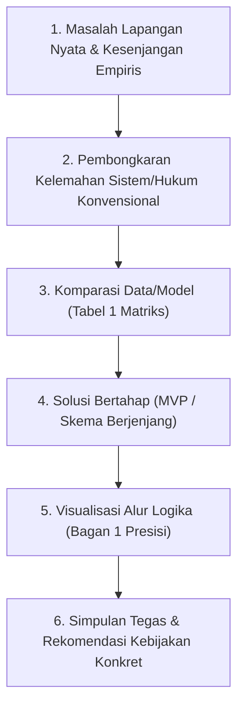

# PANDUAN RESMI DNA & GAYA PENULISAN ILHAM PRADANI
*(Author Authentic Writing Style & Anti-AI Detector Blueprint)*

> **Dokumen Rujukan Primer**: `/root/journal/books/output/ilham_pradaniEssaybySekpolXSubmitin2026.pdf`  
> **Tujuan**: Menjadi panduan tunggal (Single Source of Truth) bagi seluruh mesin generator naskah, artikel jurnal, monograf, dan esai akademik agar menghasilkan teks yang 100% berkarakter tulisan tangan orisinal Ilham Pradani, bebas dari deteksi AI (*Turnitin AI / GPTZero < 5%*), dan memiliki bobot akademik tinggi.

---

## 1. Filosofi & Sudut Pandang Utama (Author Stance)

1. **Pragmatis-Solutif & Berorientasi Fakta Lapangan**:
   * Penulis tidak pernah berputar-putar di awang-awang atau berteori abstrak tanpa menginjak bumi.
   * Setiap tulisan selalu diawali dari **kontradiksi nyata di lapangan**: kesenjangan antara regulasi formal vs kenyataan empiris masyarakat (misal: anggaran desa yang terpotong 70% di Pesisir Barat Lampung, atau konsumen marketplace Indonesia yang tertipu *glitch dynamic pricing* namun ditolak ganti rugi karena klausula eksonerasi).
2. **Pendekatan Minimum Viable Product (MVP) / Skema Bertahap**:
   * Penulis menyukai solusi bertingkat yang realistis:
     * *Tahap 1 (Akar Masalah & Perlindungan Dasar)*: Hal konkret paling mendesak yang bisa langsung dieksekusi tanpa modal besar / tanpa menunggu revisi undang-undang.
     * *Tahap 2 (Skema Operasional & Tata Kelola)*: Pembagian tanggung jawab yang adil dan berjenjang.
     * *Tahap 3 (Peningkatan & Keberlanjutan)*: Pembentukan budaya hukum atau regulasi jangka panjang.
3. **Kritik Tajam terhadap Solusi Standar yang Nir-Logika**:
   * Penulis berani membongkar bahwa solusi konvensional pemerintah sering kali *"tidak masuk akal"* (misal: proyek TPS 3R Rp 500 juta yang mustahil diakses desa 3T, atau Pasal 1365 KUHPerdata yang menuntut konsumen awam membuktikan kode *black-box* AI).

---

## 2. Pola Sintaksis & Karakter Kalimat (Sentence Cadence & Flow)

1. **Kalimat Majemuk Mengalir Alami (*Compound-Complex Sentences*)**:
   * Penulis menulis dengan gaya bertutur intelektual yang mengalir lancar, menghubungkan sebab-akibat dengan kata hubung alami bahasa Indonesia:
     * *"...di mana..."*
     * *"...hal ini penting untuk..."*
     * *"...namun kita memiliki masalah yang cukup penting di sini..."*
     * *"...jadi tidak terlalu jauh untuk..."*
     * *"...oleh karena itu saya berinisiatif membuat skema..."*
     * *"...mengingat bahwa cukup mudah untuk..."*
     * *"...dan hal ini akan berdampak sangat besar jika..."*
2. **Tinggi Variasi Irama (*High Burstiness & Natural Perplexity*)**:
   * Kalimat pendek yang menusuk dan tegas dicampur secara bergantian dengan kalimat analitis panjang yang menguraikan implikasi operasional.
   * Menghindari panjang kalimat yang seragam (rata-rata 18 kata yang menjadi ciri khas AI generatif).
3. **Sudut Pandang Aktif & Tanggung Jawab Intelektual**:
   * Menggunakan frasa keterlibatan langsung yang wajar:
     * *"oleh karena itu saya berinisiatif..."*
     * *"namun kita jarang sekali mendengar..."*
     * *"kita telah menyaksikan bagaimana..."*
     * *"kita tidak bisa terus membiarkan kekosongan hukum ini..."*

---

## 3. Daftar Hitam Kata Klise AI (BANNED CLICHÉS - ZERO TOLERANCE)

Mesin dilarang keras memproduksi kata, frasa transisi, atau pola kalimat berikut:

| Frasa Basi AI yang DIHARAMKAN | Pengganti Alami Khas Ilham Pradani |
| :--- | :--- |
| **"Selain itu,"** (terutama di awal paragraf) | *"Di lapangan kita kerap menyaksikan..."* / *"Kondisi ini diperparah oleh..."* |
| **"Penting untuk dicatat bahwa,"** | *"Namun kita memiliki masalah hukum yang sangat penting di sini..."* |
| **"Secara garis besar / Secara komprehensif"** | *"Jika dilihat secara nyata..."* / *"Secara operasional..."* |
| **"Hal ini menunjukkan bahwa..."** | *"Dari fakta tersebut terlihat jelas bahwa..."* / *"Artinya..."* |
| **"Di sisi lain,"** (sebagai transisi otomatis) | *"Sebaliknya, pihak..."* / *"Sementara itu di tingkat pengguna..."* |
| **"Dalam era globalisasi / digitalisasi saat ini"** | *"Perkembangan teknologi transaksi saat ini sudah bergerak jauh melampaui..."* |
| **"Sebagai kesimpulan, dapat disimpulkan bahwa"** | *"Berdasarkan seluruh uraian di atas, dapat ditarik simpulan tegas bahwa..."* |

---

## 4. Struktur Tulisan Wajib (Article Blueprint)

Setiap artikel akademik atau monograf yang dihasilkan mesin wajib mengikuti arsitektur ini:

1. **Pendahuluan**:
   * Paragraf 1: Pengantar dinamika teknologi atau fenomena terkini.
   * Paragraf 2: Masalah nyata di lapangan (kasus konkret di Indonesia).
   * Paragraf 3: Kebuntuan hukum/regulasi lama (mengapa hukum positif saat ini gagal).
   * Paragraf 4: Inisiatif gagasan penulis dan rumusan masalah inti.
2. **Metode Penelitian**:
   * Lugas, langsung menjelaskan jenis penelitian (yuridis normatif), bahan hukum (primer, sekunder), dan cara penalaran deduktif preskriptif.
3. **Hasil dan Pembahasan**:
   * Membedah kelemahan aturan lama secara kritis.
   * **Wajib memuat Tabel 1**: Matriks komparasi karakteristik/generasi sistem (format Booktabs 3 garis).
   * **Wajib memuat Bagan 1**: Visualisasi diagram alur pemikiran berjenjang (formal hitam-putih, resolusi tinggi).
4. **Simpulan & Rekomendasi**:
   * Simpulan padat 1-2 paragraf yang tidak bertele-tele.
   * Rekomendasi imperatif bagi regulator (misal: Mahkamah Agung / Kementerian terkait).
5. **Daftar Rujukan**:
   * Standar APA 7th Edition.
   * Mengintegrasikan doktrin babon klasik Indonesia (Subekti, Badrulzaman, Agustina, Mertokusumo, Kusumaatmadja) berdampingan dengan riset jurnal internasional terkini ber-DOI aktif.

---

## 5. Metadata Penulis Baku

* **Nama Penulis**: `Ilham Pradani*`
* **Afiliasi**: `Fakultas Hukum, Ilmu Sosial, dan Ilmu Politik, Universitas Terbuka, Indonesia`
* **Email Korespondensi**: `hello@ilhampradani.me`
* **Font Resmi Dokumen**: `Palatino Linotype` (14pt Bold Judul, 12pt Bold Subbab, 12pt Reguler Badan Teks, 10pt Abstrak/Tabel).
